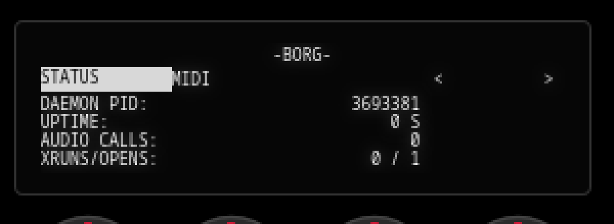
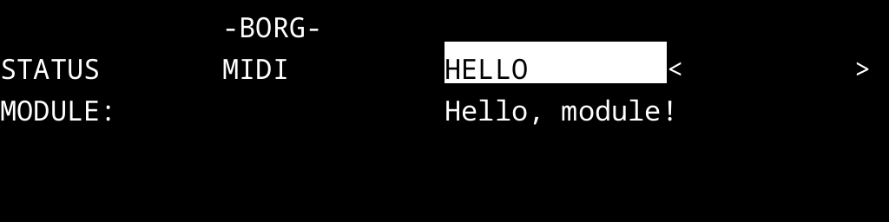

Borg
====


A synth unit that switches `drumlogued` to run extensions in place. Select
the unit and fire `GateOn()`: the daemon re-executes itself under an embedded
preload object, same pid, with no rootfs writes.




The loaded object adds a status menu, opened with MUTE and MASTER, a writable
MIDI transform for modules (the transpose and velocity controls are
`transform.borgmodule`, on its own page rather than hidden settings), and a
loader for `.borgmodule` pages kept in the instrument's userfs.

Build with

```sh 
./build-drum.sh borg_drumlogue
```

which you have to copy to `/Units/Synths`.

A basic module system is added as `.borgmodule` in `/Programs`



ABI 2 also offers MIDI to a module: every complete SysEx message from every port
the daemon reads, with the reply going out on the paired output. The
`exec.borgmodule` is the working example. It answers `@exec <command>` on the
gadget, the DIN sockets or a host-port interface, runs a command through the
kernel's usermode helper, and has a host tool:

```sh
./build-module.sh modules/exec/exec.cc
tools/borgexec.py run 'uname -a'
```

See [modules/exec/README.md](modules/exec/README.md).

ABI 4 adds a module's own audio on the daemon's playback path and every channel
MIDI message before the daemon's unit sees it. ABI 5 adds a writable MIDI
transform, so a module can change the note the daemon's unit plays;
`transform.borgmodule` is the example. ABI 1–4 modules keep working unchanged.
See [borg_drumlogue/README.md](borg_drumlogue/README.md).


Install and use are in [borg_drumlogue/README.md](borg_drumlogue/README.md).


This repo is self-contained and abstracts away some of the other experiments I have done.


## License

MIT. See [LICENSE](LICENSE).


> [!NOTE]
> "drumlogue" and "microKORG2" are trademarks of KORG Inc. Borg is independent work: it is not affiliated with, endorsed by or supported by KORG. Any damage is your own responsiblity. No reverse engineering or disassembly was used. This relies on public files provided by the logue SDK.
